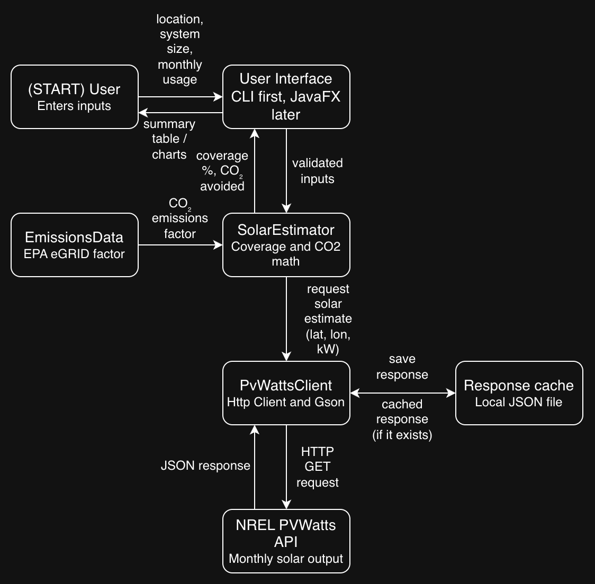

# Solar Calculator

## Project goal
A Java app that estimates how much of a household's electricity could be
covered by solar panels, and how much CO₂ that would avoid, using NREL's
PVWatts API.

## MVP scope
- Enter location, system size, and monthly electricity usage
- Fetch monthly solar production from the PVWatts API
- Show monthly coverage and annual CO₂ avoided in a command-line summary
- Unit tests for the calculations

## Future plans
- JavaFX window with charts of production vs. usage
- Compare multiple system sizes

## Tech stack
- Java 17+, Maven
- Gson (JSON parsing), JavaFX (charts), JUnit 5 (tests)
- NREL PVWatts v8 API, EPA eGRID emissions data
- Git and GitHub

## System diagram
